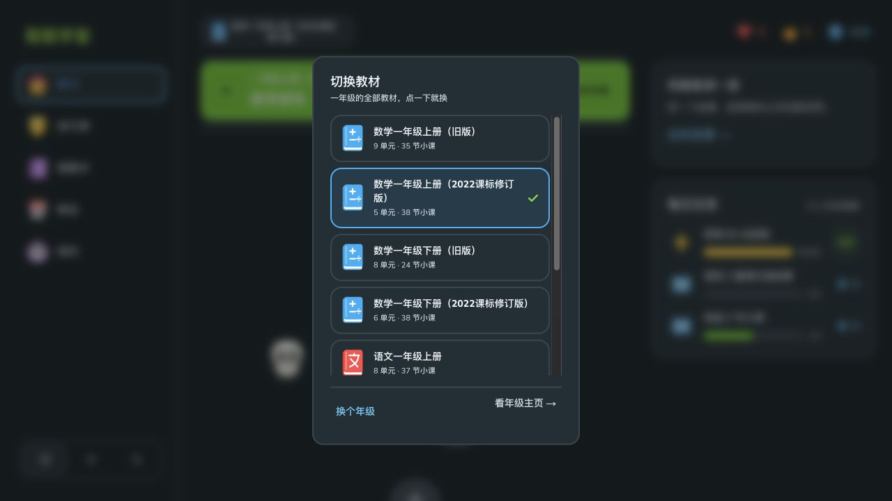

# #14 数学修订版上线验收（2026-10-25）

七册人教版数学修订版已上线：[在线课堂](https://d3nmsqi4n72idj.cloudfront.net/) · [v1.7.0 下载入口](https://github.com/wuwangzhang1216/ChinaTextbookStudyFree/releases/tag/v1.7.0)。57 个单元/实践、290 个配套小课、2,082 道题，9,945 条 Edge 配音；新版使用独立 ID，旧版和已完成成绩保留。来源与范围见[官方教材核对](issue-14-textbook-review-2026-10-25.md)。

## 测试与线上验证

| 检查 | 结果 |
| --- | --- |
| Core / iOS | 231 / 211 项通过，PR #41 CI 通过 |
| 全题库真实判题 | 24,260 题通过 |
| 双端数学语音规范 | 110,222 个文本一致；公式、循环小数、控制字符回归通过 |
| 全量静态/源码安装 | 全新安装、逐文件 SHA-256 校验通过；升级/损坏预检回归通过 |
| iOS 资源 | 58 册、116 包 CRC/SHA/数据/音频引用通过；23,920 次 AAC 解码通过 |
| 原生下载索引 | 从客户端实际资源地址获取，使用原生模型解析 58 册通过 |
| 生产存储 | 342,651 个当前站点文件完整；0 缺失、0 大小差异、0 未知额外文件；337 个历史资源保留 |
| 媒体类型 | 51,352 个扩展名例外的真实 MIME 元数据检查通过 |
| 线上教材 | 全部 3,350 个教材 JSON 与发布包逐字节一致，含音频地址 |
| 当前修订版音频 | 全部 19,925 条 Edge MP3 在线 SHA-256、MIME、nosniff 通过 |
| 入口与传输 | 164 个新旧教材/手册/音频请求通过；Range、HTTPS、私有源站通过；CDN 刷新完成 |

机器内容审校包含逐题重算与官方正文主题覆盖，但不等于教师签审或儿童实测。

## 新旧教材与成绩

同一生产站点、同一浏览器，不清除或注入存储。四个档案在部署前后的完整导出数据逐项相等。独立验证档案先完成旧课 `g1up-u1-kp1`，部署后完成新课 `g1up-2026-u101-kp1`，两课各自保留成绩；新课 6/6、三星，刷新后仍在。旧课成绩及点数示范记录不变，奖励累加不覆盖。原有三个档案在新课完成后再次导出，仍与部署前完全一致；原学习档案已恢复。原始存档仅保留本机，未公开。

四处旧公式/术语/验算精确更正保留题号和标准答案，详见[更正记录](restored-content-fixes.json)。对应尚未提交的旧课程可能按既有内容指纹规则要求重开；已完成成绩和奖励保留。

## 资源组织与源码

主入口只有 7 个上传文件（GitHub 另提供 2 个自动源码链接）。[Web 大资源](https://github.com/wuwangzhang1216/ChinaTextbookStudyFree/releases/tag/v1.7.0-web-resources)与 [iOS 分册资源](https://github.com/wuwangzhang1216/ChinaTextbookStudyFree/releases/tag/v1.7.0-ios-resources)分开；iOS 索引同时保留在分册页，供原生客户端获取。[按平台下载指南](releases/v1.7.0-downloads.md)。

三个发布标签及二进制的配套应用源码固定为 `4a9ba1bab842775d3ac45d25cbaf40290b3ed16b`，实现见 PR #41。iOS 索引是发布元数据，补齐及后续打包回归见 PR #42；公开二进制和标签未重打、未移动。此前 v1.6.0 的 125 个上传资源，其 ID、大小、SHA-256 和下载地址全部保持一致。

## 继续开放的验收

- #3：MP3 兼容性已部署并回归；iPad 6 真机反馈仍待确认。
- #7：已梳理五四制来源并询问优先年级、科目、出版社，尚未确认接入范围。
- #12：软件修复和发布已完成；教师、儿童理解/首次行动/拇指操作、真机与弱网、品牌及延迟掌握仍需真实验收。原定时追踪继续暂停。

[机器可读验收摘要](issue-14-release-2026-10-25.json)。
