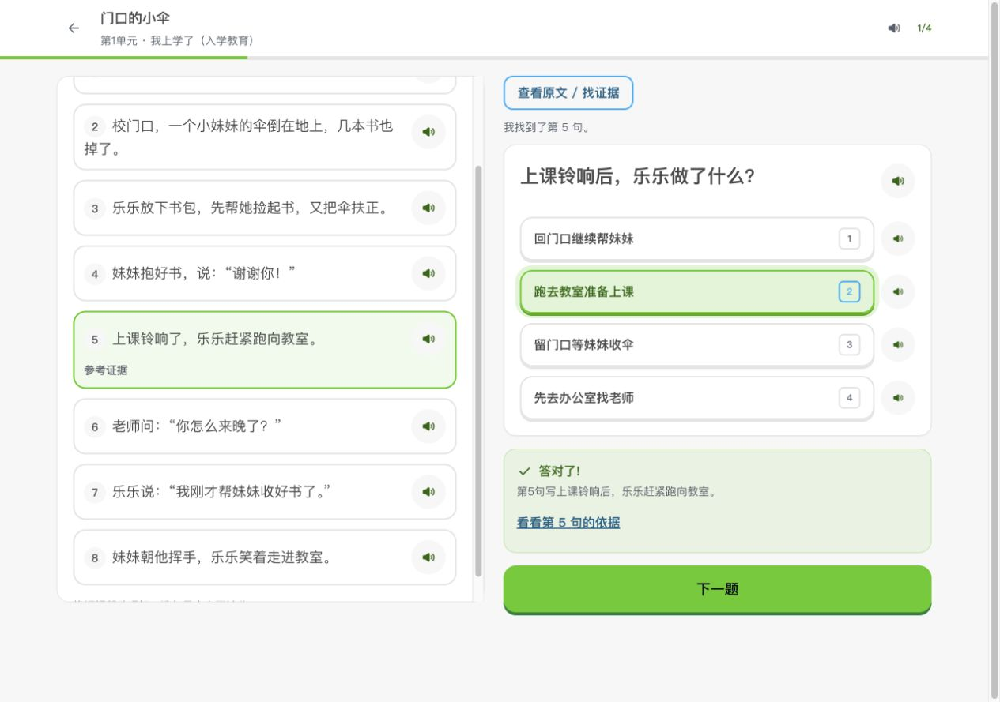
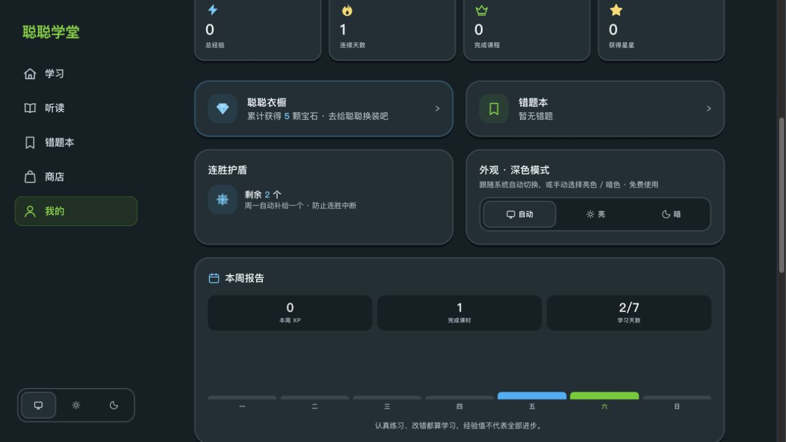
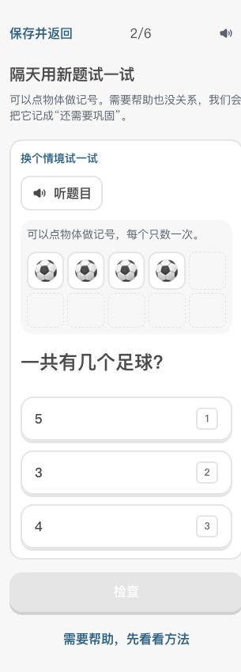

# 学习质量修复与示范单元验收

2026-10-17。范围为已确认的题目错误、周报学习口径、故事阅读证据入口，以及一年级数学第一单元的三节示范课。改动保存在 `codex/learning-quality-next`，从当前主分支建立独立工作树。

## 已完成行为

| 项目 | 验收结果 |
| --- | --- |
| 二上付钱题 | 明确“恰好付钱、不找零”；枚举一枚5角、两枚2角的组合，答案为1种。 |
| 四下小数点题 | 原数4.8不变；纠正解析中的除数，验算为 `4.8 × 100 ÷ 1000 = 480 ÷ 1000 = 0.48`。 |
| 周报 | 学习天数与XP分别记录。完成0 XP课程、阅读或复习仍算学习。新备份保留学习日和课时历史；旧档兼容读取可验证的历史记录。 |
| 故事阅读 | 桌面原文与题目并排；手机和平板可打开原文、选句、逐句朗读、返回作答。参考句仅在检查答案后显示。答案和选句在当前标签页刷新后恢复。 |
| 示范单元 | 数物体、配对比较、分配物品，三课各6题，共18题。含跟做、独立练习、换情境题和两级提示。可点击、键盘操作，无需拖拽；不扣红心，0红心也可进入。 |
| 学习证据 | 分开记录无提示首答、迁移表现、提示使用；错后改对不追认独立首答。 |
| 隔天检验 | 后一天起，每技能2道新题。求助不算独立正确；全对安排7天后巩固，否则次日再试。同日重练不产生“隔天仍会”；刷新完成页不重复发XP。 |

三节示范课使用现有课程ID，实际导出内容由 `packages/core/src/numberSense.ts` 编排，并在 `apps/web/scripts/build-data.ts` 应用。旧课程内容变化会触发既有的续做失效提示，避免用旧答案判新题。其余单元保持原有课程机制。

## 自动检查

| 检查 | 结果 |
| --- | --- |
| `npm test` | 13个文件、231项全部通过，包含题目独立算术核对、周界/跨年/夏令时、阅读证据、示范题与隔天调度。 |
| `npm run type-check` | Web与core通过。 |
| `npm run check:web-experience` | 24组判题反馈、长答案键盘、跳级加载、阅读/录音生命周期、10套主题明暗对比通过。 |
| `npm run check:learning-quality` | 实际store完成0 XP学习→周报渲染→备份往返；实际示范导出、图形渲染、隔天检验恢复/求助/防重复结算通过。 |
| 既有回归脚本 | 奖励、课程恢复/内容边界、题目草稿、复习内容/准备/恢复/会话、讲解朗读、旧音频与service worker均通过。 |
| 内容纠错检查 | 12条累计纠错与真实判题一致；135节历史审核课、818题保持审核指纹，另2节明确被新示范内容替换。新示范题独立核对，不冒用历史教师审核结论。 |
| 生产构建 | `npm exec --workspace=china-study-free -- next build` 成功，导出3,903个页面。 |
| 全站完整性 | 44本书、2,166节常规课、6,836道常规题、779篇课文、284篇故事，完整性错误0。 |
| 静态导航 | 3,900个HTML页面、5,152个引用，缺失目标0。 |
| 音频 | 78,801个引用、67,083个不同MP3资源，格式与文件检查错误0；12个实际解码样本全部通过。 |

新文本只绑定文字哈希匹配的已有音频。新示范题提供设备中文朗读；本次没有生成付费音频。纠错文本有3个语音字段暂无新录音，已移除旧引用。内容检查通过 `--allow-missing-audio` 明确允许缺省，仍对存在的录音严格核对哈希和资源，未降低默认严格检查。

新增检查已接入 `.github/workflows/web-experience.yml`；CI先生成题库，再验证三节实际导出内容。

## 浏览器验收

通过本地开发版与最终静态生产构建操作，未改浏览器时钟。隔天场景通过正式存档导入流程加载昨天完成练习的测试记录。

- 完整做完18道示范题，另做一次错题回练；点数、配对、分配、提示、课程衔接、结课和单元记录一致。
- 数数课故意错1题、另1题查看提示，显示无提示首答1/3、迁移2/2；另外两课全对显示3/3与2/2。
- 点数标记、答案和提示在刷新后保留；0红心直接进入示范课成功，普通课程仍显示原有回心与复习入口。
- 故事原文选第5句、保留已选答案、Esc返回并还焦；原文弹层中的数字键未改变背景答案。刷新后恢复；检查后第5句显示参考证据。
- 周报导入测试显示0 XP、1课时、2/7学习天数，柱状图标注已学习，无错误空态。
- 隔天检验：数数求助1题，结果1/2并安排次日；另外两技能各2/2，安排7天后。完成页刷新后周报仍为25 XP。
- 检查320、390、768、1280像素宽度，以及亮色、深色界面。320像素十格框修正后每格至少44像素、间隔4像素，无重叠和横向溢出。

## 验证边界

浏览器验收使用桌面浏览器的视口尺寸，尚未代替iOS Safari、安卓真机和真实小学生试用。设备朗读的中文声音取决于本机支持情况；不支持时提供明确提示。新示范内容已通过算术与流程验证，教师教学审阅与儿童可用性观察仍有价值。

全站结构检查不等于全题库教学认证。其余单元仍有1,174节单题微练习、1,474节缺知识讲解；这些已有覆盖问题保留在完整性报告的warnings中，没有将它们宣称为已修完。生成的JSON、音频与详细机器报告保存在本地忽略目录，重新运行构建和检查即可复验。
