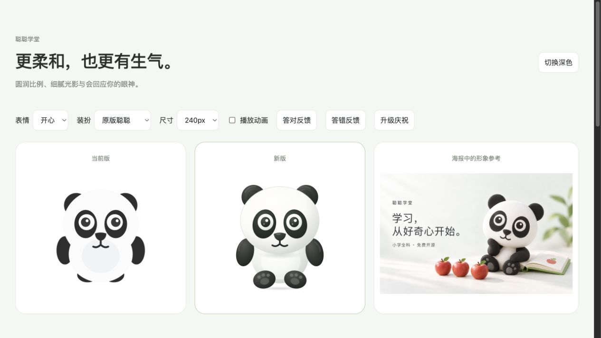

# 聪聪熊猫形象打磨

将海报中的圆润比例与柔和光影应用到 Web 的原生 SVG 吉祥物，保留表情、换装和答题反馈。

## 实现

- 更饱满的头部、躯干和脚掌，增加耳朵内侧、眼神高光、鼻部、脚垫和接触阴影。
- 保留 8 种表情、12 套装扮及原有组件接口；配件采用柔和的材质渐变。
- 待机呼吸与答题反应独立，保留眨眼、答对、答错和升级动画；静态模式与减少动态效果偏好均由同一开关控制。
- 每个 SVG 实例使用独立的渐变与可访问标题 ID。桂冠坐标统一精度，避免服务端与浏览器浮点运算造成 hydration 差异。

## 验证 · 2026-10-16

- `npm run type-check`：Web 与 Core 通过。
- `npm test`：10 个文件、216 项 Core 测试通过；这些测试不覆盖视觉与动画。
- 独立组件预览：逐一切换 8 种表情、12 套装扮；检查 32/48/64/96/144px 总览和 48/72/120/240px 主预览。
- 检查答对、答错、升级时 SVG 的实际变换；关闭动画后不触发庆祝光晕。系统减少动态效果的分支经代码核对，未模拟操作系统偏好切换。
- 同页 27 个熊猫实例的 407 个 ID 无重复，无缺失渐变引用；预览控制台无 error。
- 真实 Next.js 开发应用验证了首次年级选择与商店；390×844 视口下商店实际内容宽度及滚动宽度均为 375px。全套配件的首次 SSR 加载无 error。
- 以上为本地浏览器验证，未执行生产构建、生产发布或真机验收。

## 截图

- [浅色表情与装扮总览](expressions-wardrobe-light.jpg)
- [深色表情与装扮总览](expressions-wardrobe-dark.jpg)
- [真实商店移动端页面](shop-mobile.jpg)

组件对比预览仅用于本地评审，未加入产品路由。预览使用同一源码与旧版组件，并以已合并的海报作为参考。
