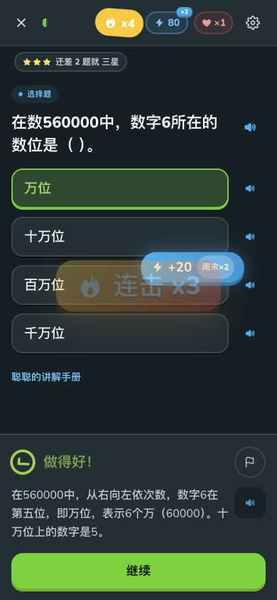
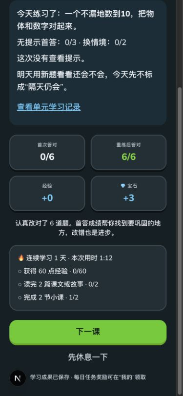
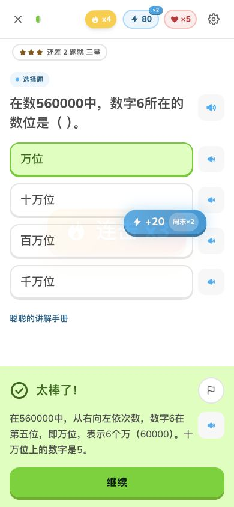

# #12 自动核验、修复与人工交接

本轮继续处理 [#12](https://github.com/wuwangzhang1216/congcong-school/issues/12)。[v1.7.1](https://github.com/wuwangzhang1216/congcong-school/releases/tag/v1.7.1) 已部署并通过生产核验；配套资源同步更新。人工验收未完成，issue 继续开放，原定时追踪保持暂停。

## 本次修复

- 深色引导选中年级卡悬停时出现浅底浅字；修复前标题与说明对比度只有1.76、1.39。选中态统一到语义样式，深色悬停使用深色表面。
- 亮暗模式的学科/导航/主按钮、状态和提示文字使用可读前景色；保留原品牌背景和图标颜色。补齐有连胜记录时才出现的数字对比度问题。
- “添加孩子”“修改当前名字”从20px点击高度增至至少44px；两个档案操作均达到44px。已达成每日任务的领取按钮为40×44px，达到本项采用的24px最低目标标准；是否适合儿童拇指仍待实测。
- 四上旧版 `g4up-u1-kp1` 题15把 `560000` 中的6错判为十万位，改为**万位**，同步解析和免费 Edge Xiaoxiao 朗读。[精确前后记录](content-rechecks.json) · [音频字节凭据](audio-repair.json)。
- 跳级通过文案改为“通过了前面知识的检测”，避免一次检测即宣称掌握。
- 旧音频检查器补齐生产环境的公式朗读规范化、全局及分册 Edge 地址映射和 SHA256 核验；对应缺失、损坏、文字或册别错误均有反例测试。CI 的无音频模式明确不声称检查了音频。

教材 ID、旧版和已完成成绩不变，不追溯重算完成成绩。上述四上课时尚未提交的会话遇到内容指纹变化需重开；已经入账的奖励保留。新音频采用新地址，没有覆盖旧音频；57册 iOS 包与v1.7.0逐字节一致，仅四上旧版同步数据和音频。

## 自动核验覆盖

|核验|结果与边界|
|---|---|
|运行时判题|24,260题无失败；“标准答案可判对”不能证明题意正确|
|独立数学核验|95道纯计算、1道数位题；942道依赖情境的计算题明确不在此解析器的证明范围|
|重点内容|135课818题指纹/判题/匹配音频，加2个动手示范课，共137课；四上有独立精确复核记录，保留原历史模型记录，不冒充教师签审|
|历史修正|12处题面/答案/解析修正逐项对应音频，0遗漏引用|
|学习状态|点数讲解进度、未提交选项、已判反馈刷新恢复；排序/部分连线草稿、内容指纹变化、旧错题更新、档案隔离和奖励回归|
|实际结算|六题先错后全部改对：首次0/6、重练6/6、经验+0、宝石+3；一页结算，一次操作进入下一课|
|网络故障|受控HTTP503、18秒停滞、2秒延迟均能重试恢复；五题巩固5/5、+25XP、只回1心，回原反馈且刷新不重复判分|
|音频失败|显示未记录完成；导出测试档案验证听读记录为空、XP未增加；恢复完整播放后才产生1条记录及+5XP|
|响应式与颜色|四档手机引导；12页面×亮暗模式；五档桌面商店宽度；全部10种主题前景对比度回归。视口模拟不作为真机或儿童验收|
|基础验证|Core231、Web/Core类型及领域回归；iOS独立生成环境211单元+13界面测试；生产导出4983页|
|资源|58册116个iOS包SHA256/ZIP CRC/引用通过，23,921条AAC解码；Web实际MP3/Opus格式和新增片段解码；新版/旧版164项HTTP检查|

软件颜色探针跳过禁用、装饰、隐藏、渐变或仍在淡入的节点，并记录跳过项；读屏专用标题不算视觉裁切。探针不是全站可访问性认证。受控网络故障不是物理弱网研究。

## 上线复验

- PR #43 的两套CI通过并已合并；三个应用/资源标签固定在 `d7c08635ac54259d42ad70a3160152cee3754aba`，没有移动标签或替换公开二进制。
- 当前站点 342,653 文件完整，缺失/大小差异/未知额外文件均为0；保留 345 个历史资源。
- 全部3,350份线上教材JSON逐字节匹配；19,925条原修订版Edge MP3加1条更正朗读，共19,926条在线SHA256/MIME/nosniff通过。新增MP3/Opus的Range请求亦通过。
- 51,352 个扩展名例外媒体的实际MIME元数据检查通过；新旧教材164项HTTP验证通过，CDN刷新完成。
- 五份线上档案在部署前后的完整数据相等，包括更正前完成的四上旧课6/6、三星；部署后重做更正课6/6通过。四个既有档案再次完整导出仍未变化，原档案已恢复；原始存档不公开。
- 静态站点342,653文件、源码334,147文件全新安装和逐文件SHA通过；原生客户端实际基址可解析58册索引。v1.6/v1.7.0共268个历史上传资源的ID、大小、SHA及URL不变。

完整机器记录：[verification.json](verification.json)。

## 剩余需要配合

请按 [具体人工操作清单](human-checklist.md) 执行，直接使用 [137课教师队列](teacher-queue.md)；[机器可读队列](teacher-queue.json)含课时链接、题号和当前内容指纹。

1. 教师按所教科目核对题干前提、独立推导、唯一答案和逐项朗读，先看数位题、概率题及12处修正，再分批完成137课。
2. 儿童15分钟试用：首次学习动作是否30秒内、能否解释首答与纠错结果、辅助按钮误触、聪聪如何帮助学习。
3. 手机和iPad6（若有）真机及真实断网/恢复测试，记录具体设备、版本、步骤和等待时间。
4. 次日及第7天用新情境题验证独立作答，不把今天完成或题量增加当作掌握证明。

没有要求上传姓名或录音。每项反馈模板、页面链接及判定边界均在清单中；这些证据回来前，UX-02/05/06/07/11/12保持未勾选。

发布后验证记录通过 v1.7.1 Release 的 `VALIDATION.json` 提供；本目录的教师/儿童待办不随软件发布自动完成。
